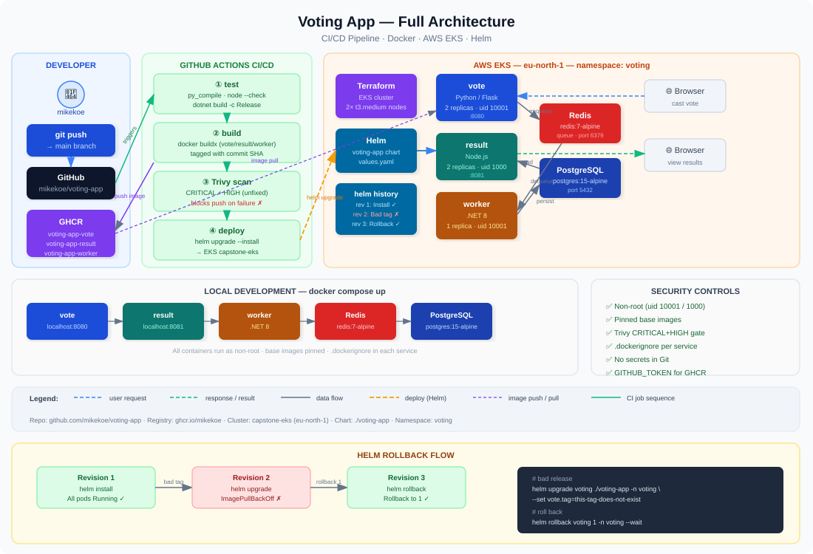

# Example Voting App

A simple distributed voting application, containerized with Docker, scanned for
vulnerabilities, deployed to Kubernetes with Helm, and built by a GitHub Actions
CI/CD pipeline.

---

## Table of Contents

1. [Architecture](#architecture)
2. [Services](#services)
3. [Run locally with Docker Compose](#run-locally-with-docker-compose)
4. [CI/CD pipeline](#cicd-pipeline)
5. [Infrastructure — Terraform on AWS EKS](#infrastructure--terraform-on-aws-eks)
6. [Deploy with Helm](#deploy-with-helm)
7. [Roll back a bad release](#roll-back-a-bad-release)
8. [Security](#security)
9. [Notes](#notes)

---

## Architecture

### Application data flow

```
Browser → vote (Python) → Redis → worker (.NET) → PostgreSQL → result (Node.js) → Browser
```


### CI/CD and infrastructure



```
Git push
   │
   ▼
GitHub Actions
   ├── test          (Python compile, Node syntax check, .NET build)
   ├── Trivy scan    (blocks on CRITICAL or HIGH unfixed CVEs)
   ├── build & push  (images tagged with commit SHA → GHCR)
   └── deploy        (helm upgrade --install → EKS cluster)

AWS EKS (eu-north-1)
   └── voting namespace
         ├── vote      (2 replicas)
         ├── result    (2 replicas)
         ├── worker    (1 replica)
         ├── redis
         └── db (PostgreSQL)
```

---

## Services

| Service | Language | Role |
|---|---|---|
| vote | Python / Flask | Front-end: cast a vote between two options |
| result | Node.js | Front-end: show live vote totals |
| worker | .NET 8 | Reads from Redis, writes to PostgreSQL |
| redis | Redis 7 | Message queue for incoming votes |
| db | PostgreSQL 15 | Persistent storage for vote totals |

---

## Run locally with Docker Compose

**Prerequisites:** [Docker Desktop](https://www.docker.com/products/docker-desktop)
(includes Docker Compose).

```bash
git clone https://github.com/mikekoe/voting-app.git
cd voting-app
docker compose up
```

| URL | What you see |
|---|---|
| http://localhost:8080 | Cast a vote |
| http://localhost:8081 | Live results |

To stop:

```bash
docker compose down
```

### What was hardened in each image

| Image | Base | User | Notes |
|---|---|---|---|
| vote | `python:3.11-slim-bookworm` | uid 10001 (appuser) | setuptools/wheel removed; multi-stage (dev + final) |
| result | `node:22-bookworm-slim` | uid 1000 (node) | npm removed from runtime image |
| worker | `dotnet/runtime:8.0` | uid 10001 (appuser) | libssl3 patched; Npgsql and System.Drawing.Common updated |

Each service folder also has a `.dockerignore` that keeps build contexts lean.

---

## CI/CD pipeline

Every push to `main` runs four jobs in order:

```
test → build-scan-push (vote) ─┐
     → build-scan-push (result)─┼→ deploy
     → build-scan-push (worker)─┘
```

### Jobs

**test**
- Compiles `vote/app.py` with `py_compile`
- Checks `result/server.js` syntax with `node --check`
- Builds the worker with `dotnet build -c Release`

**build-scan-push** (runs in parallel for vote, result, worker)
- Builds the image (vote uses the `final` stage)
- Runs Trivy with `--severity CRITICAL,HIGH --ignore-unfixed`
- Fails the pipeline if any unfixed HIGH or CRITICAL CVE is found
- Pushes to GHCR only on a successful scan, tagged with the full commit SHA

**deploy**
- Runs only on pushes to `main`, after all three build-scan-push jobs pass
- Configures AWS credentials from GitHub secrets
- Runs `helm upgrade --install` against the EKS cluster

### Image registry

Images are published to GitHub Container Registry (GHCR):

```
ghcr.io/mikekoe/voting-app-vote:<commit-sha>
ghcr.io/mikekoe/voting-app-result:<commit-sha>
ghcr.io/mikekoe/voting-app-worker:<commit-sha>
```

---

## Infrastructure — Terraform on AWS EKS

Terraform builds a Kubernetes cluster in the default VPC in `eu-north-1`.

### Prerequisites

- [Terraform](https://developer.hashicorp.com/terraform/install) 1.5+
- AWS CLI configured (`aws configure`)
- IAM permissions to create EKS clusters, IAM roles, and EC2 instances

### Build the cluster

```bash
cd k8s-terraform
terraform init
terraform plan
terraform apply
```

Takes 10–15 minutes. When complete, connect:

```bash
$(terraform output -raw kubeconfig_command)
kubectl get nodes
```

You should see 2 nodes in `Ready` state.

### Destroy the cluster

```bash
terraform destroy
aws eks list-clusters --region eu-north-1   # should return empty
```

> **Cost:** the EKS control plane costs ~$0.10/hour plus the two `t3.medium`
> nodes. Destroy the cluster when you are done to stop billing.

### Rebuild from code

The entire cluster is defined in four files:

```
k8s-terraform/
├── versions.tf    # provider pins
├── variables.tf   # region, cluster name, instance type
├── main.tf        # VPC lookup, IAM roles, EKS cluster, node group
└── outputs.tf     # cluster name, endpoint, kubeconfig command
```

Running `terraform apply` on a clean account recreates the cluster identically.

---

## Deploy with Helm

### Prerequisites

- [Helm](https://helm.sh/docs/intro/install/) 3+
- `kubectl` pointed at the EKS cluster

### Install

```bash
helm install voting ./voting-app \
  --namespace voting --create-namespace \
  --set image.tag=<commit-sha> \
  --wait --timeout 5m

kubectl get pods -n voting
```

All seven pods should reach `Running`:

| Pod | Replicas |
|---|---|
| vote | 2 |
| result | 2 |
| worker | 1 |
| redis | 1 |
| db | 1 |

### Upgrade

```bash
helm upgrade voting ./voting-app \
  --namespace voting \
  --set image.tag=<new-commit-sha> \
  --wait --timeout 5m
```

### Uninstall

```bash
helm uninstall voting -n voting
```

---

## Roll back a bad release

This demonstrates Helm revision history and rollback.

### 1. Check revision history after a good install

```bash
helm history voting -n voting
```

```
REVISION  STATUS      DESCRIPTION
1         deployed    Install complete
```

### 2. Ship a broken release on purpose

```bash
helm upgrade voting ./voting-app -n voting \
  --set vote.tag=this-tag-does-not-exist

kubectl get pods -n voting
# vote pod enters ErrImagePull / ImagePullBackOff
# old vote pods keep running (rolling update holds them)

helm history voting -n voting
```

```
REVISION  STATUS      DESCRIPTION
1         superseded  Install complete
2         deployed    Upgrade complete   ← broken
```

### 3. Roll back

```bash
helm rollback voting 1 -n voting --wait
kubectl get pods -n voting      # all Running again
helm history voting -n voting
```

```
REVISION  STATUS      DESCRIPTION
1         superseded  Install complete
2         superseded  Upgrade complete
3         deployed    Rollback to 1     ← restored
```

Confirm the image is back to the good tag:

```bash
kubectl get deploy vote -n voting \
  -o jsonpath='{.spec.template.spec.containers[0].image}'
```

---

## Security

| Control | Detail |
|---|---|
| Non-root containers | vote uid 10001, result uid 1000, worker uid 10001 |
| Pinned base images | specific tags on all three Dockerfiles and `redis:7-alpine` in compose |
| `.dockerignore` | in each service folder; keeps build context lean |
| Vulnerability scanning | Trivy in CI blocks on CRITICAL/HIGH unfixed CVEs before any push |
| No secrets in Git | GHCR uses `GITHUB_TOKEN`; AWS keys are GitHub repo secrets only |

---

## Notes

- The voting application accepts one vote per browser session.
- `db` uses `emptyDir` in Kubernetes (votes are lost if the pod restarts).
  A PersistentVolumeClaim would be needed for production.
- The services are named `redis` and `db` in Kubernetes because the upstream
  app hardcodes those hostnames.
- This is a learning project demonstrating Docker, CI/CD, Terraform, Helm,
  and Kubernetes — not a production-grade architecture.
